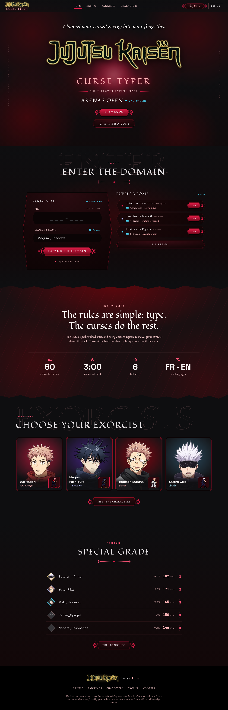
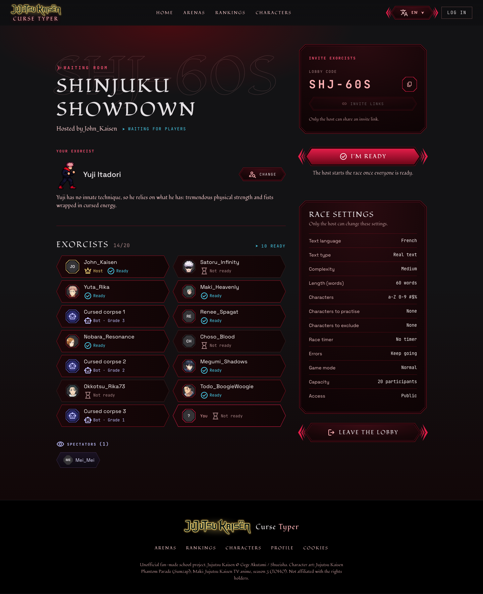
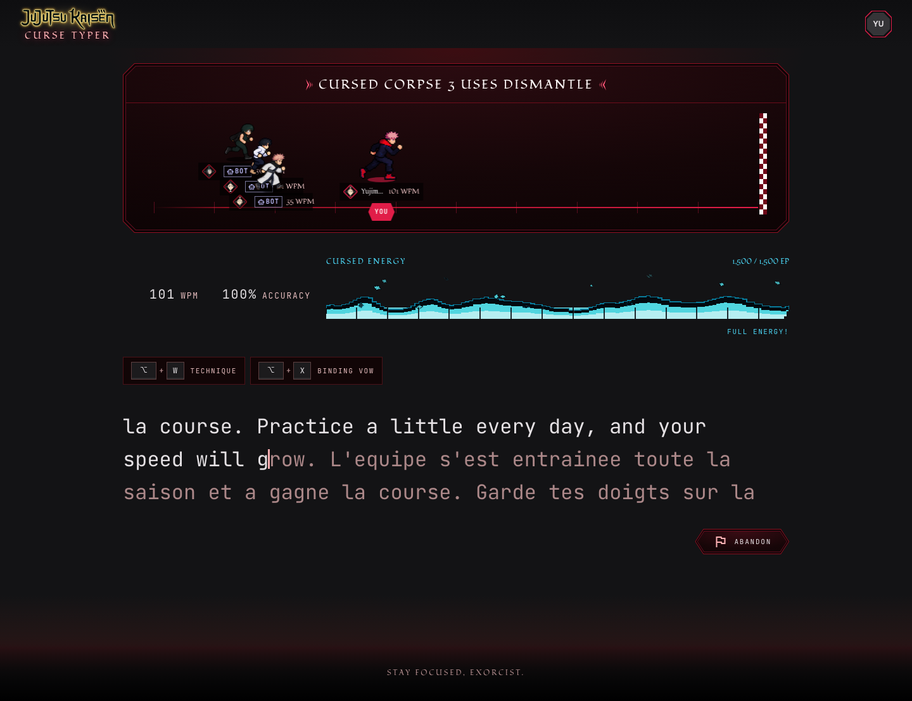
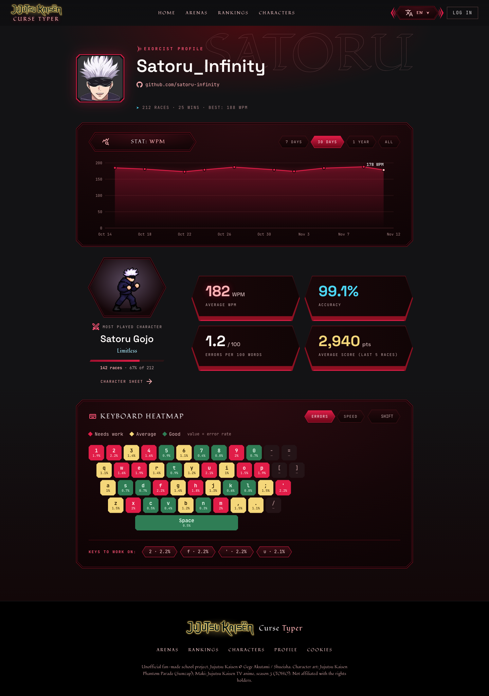

# JJK Curse Typer

Course de frappe au clavier multijoueur en temps réel, inspirée de MonkeyType et de l'univers de Jujutsu Kaisen.
Tous les participants tapent le même texte ; la progression de chacun est diffusée en direct, puis un podium et des statistiques (dont une carte de chaleur du clavier) montrent ce qu'il reste à travailler.

**Production :** TODO (URL Railway)

## Captures d'écran

<!-- Générées par `npm run screenshots` ; copier les meilleures dans docs/images/captures/ -->
| Accueil | Salle d'attente | Course |
|---|---|---|
|  |  |  |

| Classement | Profil |
|---|---|
|  |  |

## Compte de démonstration

| Nom d'utilisateur | Mot de passe |
|---|---|
| `demo` | `curse-typer-demo` |

Créé par `npm run db:seed`, avec 48 courses sur deux mois, une carte de chaleur du clavier et des statistiques de personnages.
Le seed crée aussi 11 autres comptes (mot de passe : `<nom>-demo-pass`, par exemple `kenji_t-demo-pass`) pour remplir le classement.

## Technologies

- **Next.js 16** (App Router), **React 19**, **TypeScript** strict
- **Tailwind CSS 4**
- **PostgreSQL** + **Drizzle ORM** (migrations versionnées)
- **WebSocket** (`ws`) dans un serveur Node unique (`server.ts`), tick agrégé à 5 Hz
- **next-intl** (FR/EN), **zod** (validation), **@node-rs/argon2** et **arctic** (auth, OAuth Discord/GitHub)
- **Vitest** (unitaires), **Playwright** (bout en bout), **GitHub Actions** (CI)
- Déploiement : **Railway** (application et base PostgreSQL)

## Installation locale

Prérequis : Node.js 24 (version de la CI), npm, Docker.

```bash
git clone https://github.com/Chab2005/MonkeyTyper.git
cd MonkeyTyper
npm install
cp .env.example .env          # puis remplir AUTH_SECRET (voir ci-dessous)
docker compose up -d          # PostgreSQL 17 sur localhost:5432
npm run db:migrate            # applique les migrations
npm run db:seed               # comptes de démonstration et historique (relançable sans doublon)
npm run dev                   # http://localhost:3000
```

## Variables d'environnement

Toutes documentées dans [`.env.example`](.env.example).

| Variable | Obligatoire | Rôle |
|---|---|---|
| `DATABASE_URL` | oui | Chaîne de connexion PostgreSQL |
| `AUTH_SECRET` | en production | Clé qui signe les cookies (`openssl rand -base64 32`) |
| `APP_URL` | oui | URL publique, base des retours OAuth (`…/api/auth/<provider>/callback`) |
| `DISCORD_CLIENT_ID`, `DISCORD_CLIENT_SECRET` | non | OAuth Discord |
| `GITHUB_CLIENT_ID`, `GITHUB_CLIENT_SECRET` | non | OAuth GitHub |
| `SHOW_SAMPLE_DATA` | non | `1` réaffiche les données de démonstration en production |

## Scripts

| Commande | Effet |
|---|---|
| `npm run dev` | Serveur de développement (Next.js + WebSocket) |
| `npm run build` / `npm start` | Build et serveur de production |
| `npm run lint` | ESLint |
| `npm run typecheck` | `tsc --noEmit` |
| `npm run db:generate` / `db:migrate` / `db:studio` | Drizzle : générer, appliquer, explorer |
| `npm run db:seed` | Données de démonstration (`scripts/seed.ts`) : 12 comptes, ~450 courses, heatmaps, personnages. Idempotent, ne touche pas aux autres comptes |

## Tests

```bash
npm test                      # tests unitaires (Vitest) — tests/
npx playwright install        # une seule fois
npm run test:e2e              # tests de bout en bout (Playwright) — e2e/
npm run screenshots           # captures desktop et mobile
```

La CI (`.github/workflows/test.yml`) exécute lint, typecheck et tests unitaires à chaque push et PR sur `main` et `dev`.

## Documentation

- [Architecture](docs/ARCHITECTURE.md) — modèle de données, machine à états, flux temps réel, ADR
- [Boucle de course](docs/RACE-LOOP.md)
- [Matrice des exigences](docs/EXIGENCES.md)
- [Démarche créative](docs/DEMARCHE-CREATIVE.md)
- [Utilisation de l'IA](docs/IA.md)
