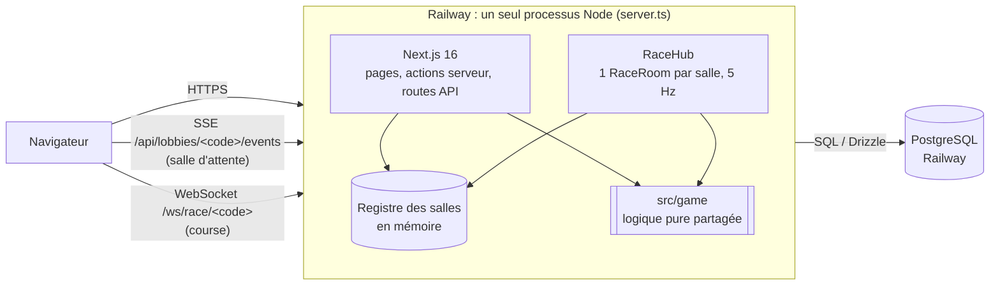
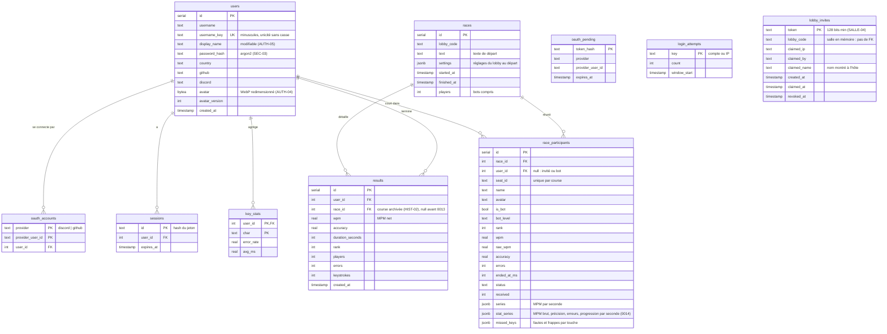
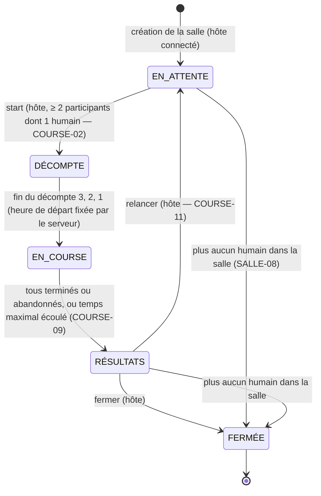
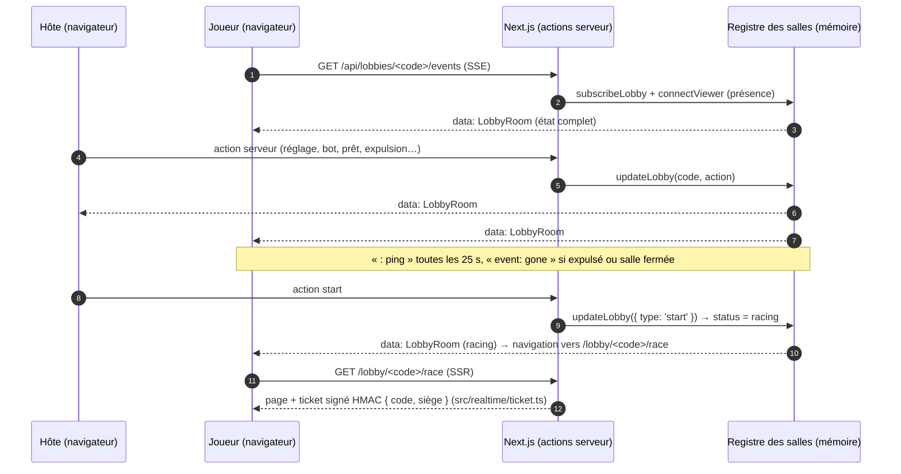
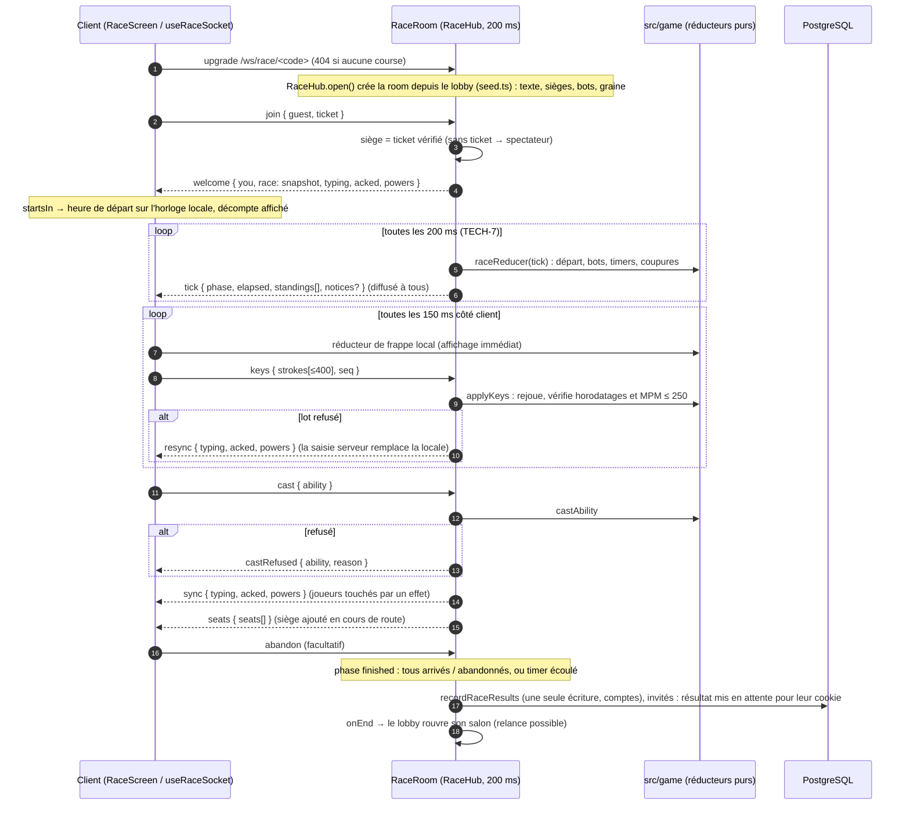

# Architecture — Curse Typer

Version finale. Les identifiants d'exigences (TECH-06, COURSE-01…) renvoient à l'énoncé
`Web-V-Travail-de-session.pdf`. Le détail des règles de la course est dans [`RACE-LOOP.md`](RACE-LOOP.md).

## 1. Vue d'ensemble

- **Un seul processus** (`server.ts`) sert Next.js et accepte les WebSocket de course. Aucun service temps réel tiers.
- **État des salles en mémoire** (`src/lib/lobbies.ts`) : une salle vit le temps d'une session de jeu et change
  plusieurs fois par seconde. Seuls les comptes, les sessions, les résultats et les liens d'invitation vont en base.
- **Logique de jeu pure** dans `src/game/` (réducteurs `état + événement → nouvel état`, sans I/O), importée par le
  client pour l'affichage instantané et par la room pour la vérité serveur (COURSE-06). Testée sans mock.
- **Limite de tentatives sur les codes (SALLE-10)** : au plus **10 échecs par IP sur une minute glissante**
  (`src/lib/codeAttempts.ts`, logique pure ; registre `src/lib/codeGuard.ts`). Un échec : un code qui ne mène à aucune
  salle ou dont l'accès est refusé (privée sans lien, expulsé, course en cours). Une entrée réussie ne compte pas.
  Les quatre portes d'entrée passent par la même règle : la page du salon et celle de la course (`openLobby`, mémorisé
  par requête pour que métadonnées et page ne comptent qu'une fois), `joinLobbyAction`, le flux
  `GET /api/lobbies/<code>/events` et l'upgrade WebSocket `/ws/race/<code>`. Une IP bloquée est refusée **même avec un
  bon code** (sinon le blocage dirait quels codes existent), et chaque tentative pendant le blocage compte encore :
  insister prolonge le blocage. Réponse : HTTP 429 avec `Retry-After` sur les routes (SSE, WebSocket), page traduite
  « Trop de tentatives » sur les pages, `{ blocked: true }` pour l'action. Exemptés : qui est déjà dans le salon
  (rechargement, reconnexion du flux) et le joueur dont le ticket de siège signé est passé dans l'URL du WebSocket.
  IP : `X-Real-IP`, sinon `X-Forwarded-For`, sinon l'adresse de la socket (WebSocket). **Compteurs en mémoire** sur
  `globalThis`, comme le registre des salles : la production tourne en une seule instance, aucune écriture en base à
  chaque tentative, et un redémarrage, qui efface les salles, efface aussi les compteurs. Plusieurs instances
  demanderaient une table (comme `login_attempts`) ou un magasin partagé.
- **Déploiement** : Railway (`railway.json`) construit avec `npm run build`, applique les migrations
  (`preDeployCommand: npm run db:migrate`), puis lance `npm start`. HTTPS fourni par Railway.
  Base PostgreSQL hébergée dans le même projet Railway (`DATABASE_URL` fournie par Railway).

## 2. Modèle de données

Tables actuelles (`src/db/schema.ts`, migrations versionnées dans `drizzle/`).

Aucune adresse courriel n'est stockée, même si le fournisseur OAuth en transmet une.
Les invités n'ont pas de ligne en base : leur session est un cookie signé (`src/lib/auth/guestCookie.ts`).

### Évolutions prévues pour la remise finale

| Table prévue | Rôle | Exigences |
|---|---|---|
| `races` + `race_participants` | **Faites** (`drizzle/0013_race_history.sql`) : une course archivée en fin de course avec tous ses participants, bots et invités compris (rang, MPM net et brut, précision, erreurs, temps, statut, bonus reçus, série du MPM, touches ratées). `results` reste la source des statistiques (sans bots) et pointe vers la course par `race_id`, nullable pour les lignes d'avant. | RES-05, HIST-01, HIST-02 |
| `passages` | Corpus de textes cohérents : langue, complexité, texte, source | CONF-03, CONF-05, TECH-04 (seed) |
| `room_members` | Appartenance courante à une salle, clé unique sur la personne : une seule salle à la fois garantie par la base | SALLE-06 |

## 3. Machine à états d'une course (COURSE-01)

| État | Où il vit dans le code | Qui peut entrer (SALLE-09) |
|---|---|---|
| `EN_ATTENTE` | `LobbyRoom.status = 'waiting'` (`src/components/lobby/lobbyRoom.ts`) | Oui |
| `DÉCOMPTE` | `LobbyRoom.status = 'racing'` + `RaceState.phase = 'countdown'` (`src/game/race.ts`), texte révélé à ce moment (COURSE-03) | Non (refusé, SALLE-09) |
| `EN_COURSE` | `LobbyRoom.status = 'racing'` + `RaceState.phase = 'racing'` | Non (refusé, SALLE-09) |
| `RÉSULTATS` | `LobbyRoom.status = 'results'` (posé par `finish`), affiché sur la page de course | Oui : on arrive sur l'écran des résultats ; seul l'hôte relance (COURSE-11) |
| `FERMÉE` | `LobbyRoom.status = 'closed'` (fermeture par l'hôte, ou dernier humain parti), puis salle retirée du registre (`src/lib/lobbies.ts`) ; ses liens d'invitation sont supprimés (SALLE-04) | — |

Transitions : chaque événement passe par un réducteur pur (`lobbyReducer`, `applyKeys`, `tick`). Le serveur est seul
à les appliquer ; le client ne fait qu'afficher. Les transitions permises sont dans la table `TRANSITIONS`
(`lobbyRoom.ts`, `canTransition`) ; toute autre est refusée (le salon reste inchangé). À la fin d'une course le salon
passe en `RÉSULTATS` (`finish`) et y reste : seul l'hôte choisit la suite, depuis l'écran des résultats (COURSE-11).
`restart` le ramène en `EN_ATTENTE` (mêmes participants, bots et réglages, « prêt » remis à zéro sauf pour l'hôte) ;
`close` le passe en `FERMÉE`, en fait sortir tout le monde et le retire du registre. Détail dans `RACE-LOOP.md` §1.

Statut de chaque participant pendant `EN_COURSE` : `racing → finished | timeout | abandoned`. Le classement final
suit COURSE-10 : terminés par temps d'arrivée, puis temps écoulé par progression, puis abandons par progression.

## 4. ADR-001 — Technologie temps réel

**Statut** : accepté (remplace le plan initial PartyKit de `PLAN.md`).

### Contexte

- TECH-06 : progression de tous les participants en direct, au moins ~4 mises à jour perçues par seconde (COURSE-05).
- COURSE-06 : le serveur est la source de vérité (départ, progression, classement, bonus) et rejette les progressions
  impossibles. Il faut donc **du code serveur avec une boucle** (timers, bots, validation), pas un simple relais.
- PERF-02 / PERF-03 : jusqu'à 30 participants par salle, messages regroupés, aucune écriture en base par frappe.
- TECH-08 : aucun service externe payant.

### Options considérées

| Option | Logique serveur (bots, timers, validation) | Coût / limites | Verdict |
|---|---|---|---|
| Pusher / Ably / Supabase Realtime | Non : relais de messages ; la logique retomberait sur un client (triche) ou du serverless sans boucle | Quotas gratuits comptés par message livré : 30 joueurs × 30 destinataires × 5 Hz les épuisent vite | Rejeté |
| PartyKit / Cloudflare Durable Objects | Oui | Gratuit, mais 2ᵉ déploiement, 2ᵉ runtime, code de jeu à partager entre deux plateformes | Plan initial, abandonné |
| Socket.IO | Oui | Dépendance lourde ; rooms et reconnexion déjà gérées par notre propre code | Non retenu |
| **`ws` dans un serveur Next personnalisé + SSE** | **Oui, dans le même processus que Next** | Aucun coût supplémentaire ; une seule instance | **Retenu** |

### Décision

- **Course** : WebSocket (`ws`) sur `/ws/race/<code>`, branché sur le serveur HTTP de `server.ts`
  (`src/realtime/attach.ts`). `RaceHub` garde une `RaceRoom` par salle avec une minuterie de **200 ms (5 Hz)**.
  - Client → serveur : `join` (avec un ticket signé qui donne le siège), `keys` (frappes groupées toutes les ~150 ms,
    400 au plus par lot), `abandon`. Tous validés par zod (`src/game/protocol.ts`, TECH-07).
  - Serveur → client : `welcome` (instantané de la course et reprise de la saisie), `tick` agrégé à 5 Hz
    (classement de tous), `resync` (lot refusé : la saisie validée par le serveur remplace celle du client).
  - Le client n'envoie jamais sa progression : la room **rejoue les frappes** dans le même réducteur pur que le
    client, refuse les horodatages incohérents et un MPM brut au-delà d'un plafond plausible.
- **Salle d'attente** : Server-Sent Events sur `GET /api/lobbies/<code>/events`. Chaque changement de la salle
  (arrivée, départ, réglage, prêt, expulsion) est poussé à tous les présents. Les actions passent par des actions
  serveur (requêtes HTTP ordinaires) ; le flux ne fait que descendre, d'où SSE plutôt qu'un 2ᵉ WebSocket.
  Garder le flux ouvert vaut présence (`src/lib/lobbyPresence.ts`, délai de grâce de 10 s).

### Conséquences

- Un seul déploiement, un seul langage, la même logique pure côté client et serveur.
- L'état des salles est en mémoire : **une seule instance** en production, et un redéploiement vide les salles en
  cours. Acceptable pour l'usage visé ; une mise à l'échelle demanderait Redis (pub/sub + état) ou un collant par salle.
- L'hébergeur doit accepter des connexions longues (Railway : oui ; Vercel serverless : non, d'où le choix de Railway).
- Une écriture en base seulement à la fin d'une course (`src/realtime/recordResults.ts`), jamais par frappe (PERF-02).

## 5. Gestion des bots

- **Moteur pur et déterministe** (`src/game/bots.ts`, BOT-05) : un bot est un état `{ profil, graine, MPM du
  moment, prochaine frappe, file de corrections }`. `nextBotStroke(bot, saisie)` rend la prochaine frappe et le
  nouvel état ; le hasard vient d'un PRNG seedé (`src/game/random.ts`). Même graine → même course : testable.
- **Même chemin que les humains** : les frappes d'un bot passent par le même réducteur de frappe que celles d'un
  joueur. Progression, MPM, précision et classement sont donc calculés à l'identique, et les bonus s'appliqueront
  aux bots sans code spécial (BOT-04).
- **Simulation côté serveur** : à chaque tick de 200 ms, la room fait taper chaque bot jusqu'à l'instant courant.
  Les bots ne sont jamais persistés en base.
- **Variation de vitesse** (BOT-02) : nouveau MPM tiré à chaque mot (0,75× à 1,25× du profil) et intervalle entre
  touches de 0,6× à 1,4×. Prévu : ralentir sur les mots longs ou rares, et des hésitations ponctuelles.
- **Erreurs** (BOT-03) : à chaque caractère, probabilité de faute selon le niveau ; le bot tape une mauvaise lettre,
  marque une pause de 250 ms, puis corrige en respectant le mode d'erreur (Retour arrière en mode libre, retape
  directement en mode correction obligatoire).
- **Niveaux** (BOT-01) — valeurs actuelles, à aligner sur les cinq niveaux de l'énoncé :

| Niveau énoncé | Identifiant actuel | MPM moyen | Taux d'erreur |
|---|---|---|---|
| Noob (10–20) | `grade_4` | 15 | 12 % |
| Débutant (20–35) | `grade_3` | 27 | 8 % |
| Intermédiaire (35–60) | `grade_2` | 47 | 5 % |
| Expert (70–100) | `grade_1` | 85 | 2 % |
| Impossible (140+) | `special_grade` | 140 | 0,5 % |
| — (niveau en trop) | `calamity_grade` | 180 | 0,01 % |

- **Identification** (BOT-04) : un bot est un participant de type `bot` ; l'interface l'affiche avec son niveau.
- **Configuration** (CONF-10) : l'hôte ajoute ou retire des bots et choisit leur niveau dans la salle d'attente.

## 6. Flux des messages temps réel

Deux canaux, tous deux servis par le même processus (`server.ts`) : **SSE** pour la salle d'attente (le serveur pousse,
les actions remontent par des actions serveur HTTP), **WebSocket** pour la course (frappes dans les deux sens, 5 Hz).
Les types des messages de course sont dans `src/game/protocol.ts` ; tout message reçu est validé par zod
(`parseClientMessage`), un message mal formé est ignoré.

### 6.1 Salle d'attente → départ de la course

### 6.2 Course

### 6.3 Messages

| Sens | Type | Contenu | Quand |
|---|---|---|---|
| C → S | `join` | `guest` (id de l'onglet / invité), `ticket` signé | Ouverture du socket, à chaque reconnexion |
| C → S | `keys` | lot de frappes `{ key, t }` (≤ 400), `seq` de la dernière | Toutes les 150 ms s'il y a des frappes |
| C → S | `cast` | capacité à lancer | Le joueur déclenche un bonus |
| C → S | `abandon` | — | Bouton d'abandon |
| S → C | `welcome` | siège, instantané (phase, `startsIn`, texte, mode d'erreur, timer, sièges), saisie à reprendre | Réponse à `join` |
| S → C | `tick` | phase, temps écoulé, classement agrégé de tous, annonces (bonus, dépassements) | 5 fois par seconde, à tous |
| S → C | `resync` | saisie validée par le serveur + numéro de la dernière frappe acceptée | Lot refusé |
| S → C | `sync` | idem | Un effet a modifié la saisie du joueur |
| S → C | `seats` | liste des sièges | Un coureur s'ajoute en cours de course |
| S → C | `castRefused` | capacité, raison | Bonus refusé |
| S → C | `records` | sièges qui ont battu leur record personnel (RES-04), validés par zod à la réception | Une fois, après l'enregistrement de la course ; renvoyé à qui arrive ensuite |

### 6.4 Coupure et reprise (RACE-13, TECH-9)

- Le client se reconnecte seul, avec un délai exponentiel de 0,5 s à 5 s (`useRaceSocket.ts`), et renvoie `join`.
- La room garde le siège de chaque invité (`seatsByGuest`) : à la reprise, `welcome` renvoie la saisie serveur et
  `acked` ; le client rejoue par-dessus les frappes locales postérieures à `acked` (`src/game/strokeLog.ts`).
- Le temps de course continue pendant la coupure. Au-delà de `RECONNECT_GRACE_MS` (30 s), le coureur est déclaré
  abandonné au tick suivant. Une coupure pendant le décompte libère le siège.
- Une room vide ferme au bout d'une minute ; une course finie ferme dès qu'elle est vide.

## 7. ADR-002 — Gestion des bots

**Statut** : accepté. Le détail du moteur est en section 5.

### Contexte

- Les bots sont des participants à part entière (BOT-1, BOT-4) : ils progressent, dépassent, apparaissent au classement
  et subissent les bonus comme les humains, et en utilisent eux-mêmes.
- Le serveur est la source de vérité (COURSE-06) : la progression d'un bot doit être aussi incontestable que celle
  d'un joueur, et identique pour tous les écrans.
- Le moteur doit être déterministe à partir d'une graine pour être testable (BOT-05), avec une vitesse variable et des
  fautes corrigées (BOT-02, BOT-03).
- 30 participants par salle, 5 Hz, un seul processus Node : la simulation doit être légère.

### Options considérées

| Option | Avantages | Inconvénients | Verdict |
|---|---|---|---|
| Bots simulés dans le navigateur de l'hôte | Aucun calcul serveur | L'hôte peut tricher ou se déconnecter ; chaque écran verrait autre chose | Rejeté |
| Progression interpolée (courbe de % en fonction du temps) | Très simple, très léger | Pas de vraies frappes : MPM, précision, fautes et effets des bonus à recoder à part ; bots traités différemment des joueurs | Rejeté |
| Processus ou worker par bot | Isolation | Coût mémoire et synchronisation disproportionnés pour quelques frappes par seconde | Rejeté |
| **Frappes simulées côté serveur, seedées, rejouées par le même réducteur que les joueurs** | Un seul chemin de calcul pour tous ; déterministe ; testable sans mock | Le serveur fait taper chaque bot à chaque tick | **Retenu** |

### Décision

- `src/game/bots.ts` est **pur** : `nextBotStroke(état du bot, saisie)` rend la prochaine frappe et le nouvel état.
  Le hasard vient d'un PRNG seedé (`src/game/random.ts`) dont la graine dérive de celle de la course et de l'id du siège.
- À chaque tick (200 ms), le réducteur de course fait taper chaque bot jusqu'à l'instant courant (`runBots`) ; ses
  frappes passent par le **même réducteur de frappe** que celles des joueurs (mode d'erreur compris), donc progression,
  MPM, précision et classement sont calculés à l'identique.
- Les effets des bonus (gel, retard, texte ajouté) agissent sur l'état du coureur, pas sur la nature du participant : un
  bot les subit sans code spécial. Il lance aussi des bonus à intervalles tirés au hasard (`nextBotCast`).
- Les bots s'arrêtent quand le dernier humain a fini : la course n'attend jamais un bot.
- Les résultats des bots ne sont jamais écrits en base ni comptés dans les statistiques (BOT-5, H-6).

### Conséquences

- Une course est entièrement rejouable à partir de sa graine : les tests (`tests/game/bots.test.ts`,
  `tests/game/race.test.ts`) vérifient vitesses, taux de fautes et classements sans horloge ni réseau.
- Coût serveur proportionnel au nombre de frappes simulées : quelques dizaines par tick pour une salle pleine, négligeable.
- Un bot ne peut pas « tricher » ni diverger d'un écran à l'autre : les clients ne reçoivent que le classement agrégé.
- Écart connu : 6 niveaux au lieu des 5 de l'énoncé (section 5), à aligner.
