# Démarche créative

## Le thème :

Le theme est sur la série Jujutsu Kaisen. Un série d'anime japonaise sortie dont la troisième saison est sortie au début de cette année. Pourquoi cette série a été choisi au leiu d'une autre. Parce que j'aime bien et lors de la premiere présentation du projet. Lorsque le client a parlé à propos de gamification et de bonus. Plein d'idée me sont venu instantanément pour rendre le `type racer` plus intéressant. En lien avec le système de magie de la série.

## Le nom :

Pour le nom, ca été assez simple, la franchise JJK(Jujustu Kaisen) a d'autres séries et média que son anime et manga. Comme la suite, `JJK Modulo` ou bien un film qui se passe avant les évenement de la série ; `JJK 0`. En plus de cela, des jeux vidéos. Donc pour le nom, j'ai choisi `JJK Curse Typer`, suivant la nomenclature des autres média de la franchise.

Un nom envisagé a été `JJK Curse Typing`, mais j'ai trouvé au final que `Curse Typer` sonnait mieux. Donc, c'est pour celà que le nom a été retenu.

## Inspiration visuel

### Style général du site

J'ai eu plusieurs inspirations pour l'apparence du site web et ses différentes parties. Pour la couleur principale du site web, le rouge, ca provient de l'antagoniste principal de la série, Sukuna. À chaque fois qu'il apparait dans la série, la couleur rouge est quasiment tout le temps présente. De plus, il y a le site officiel de la série dont je me suis inspiré. Dont la page principal contient Sukuna ; <a href="https://jujutsukaisen.jp/">https://jujutsukaisen.jp/</a>. Aussi, la technique (son pouvoir) de Sukuna est essentiellement de couper, j'ai pris sa technique comme inspiration pour des éléments comme les liens dans la barre de navigation. Qui sont des parralélogrammes, soit comme si ca serait "coupé". Cette logique est appliqué dans d'autres éléments comme les biseaux mis sur le menu pour rentrer un code, le bouton pour la langue et la photo de profil d'un utilisateur connecté. 
 

### Section héro de la page principale

Dans la section héro, l'effet d'éclair provient de deux endroits, d'un site web pour un jeu de la franchise JJK ; <a href="https://jjkrsurvivaton.shueisha-games.com/en/">https://jjkrsurvivaton.shueisha-games.com/en/</a>. Aussi, d'une attaque dans la série qui est représenté par des éclairs rouges.

### Page arénas

La page de lobbie est vraiment simple. C'est simplement une menu de recherche avec les résultats qui sortent selon les filtres appliqués par l'utilisateur. Un détail important que je veux mentionner est le mélange de typographie de JetBrain Mono et de Fondamento.

### Page de classement

La page de classement est là pour incité les utilisateurs à se pousser et faire participer d'avantage les utilisateurs du site. L'insipiration pour la disposition de la page, provient de la page de classement de U.gg ; <a href="https://u.gg/lolleaderboards/" >https://u.gg/lol/leaderboards/</a>.

### Page d'archives

#### IMPORTANT :

La page mène encore a la page de profil, dans la version finale, elle sera complète et présentera les personnages, leurs techniques, abiletés et des instructions de comment joueravec les divers bonus.

Lorsque la page sera finit, elle ressemblera à la section de personnage d'un autre jeu JJK ; <a href="https://jujutsuphanpara.biligames.com/#character-sec">https://jujutsuphanpara.biligames.com/#character-sec</a>. Cependant, elle gardera le style général du site web.

### Page de profil

La page de profil est aussi simple. La première partie est destiné a l'utilisateur dont on regarde le profil, soit le pseudo, les liens sociaux, l'handle et des stats rapides comme le nombre de course faite, le partie gagné et le MPM (mot par minute).

En-dessous, il y a le graphique d'évolution de l'utilisateur avec la ligne du temps pour le MPM. Par la suite, il y a d'autre statistique comme le MPM moyen, la précision, le nombre d'erreur de l'utilisateur par 100 mots et le nombre de points moyen obtenus par l'utilisateur. Et enfin, la heatmap des erreurs faites au clavier. 

### La non-présence du mode clair

Personnellement, je trouve que le mettre un style clair serait significativement moins beau. Aussi, l'effet d'éclair serait essentiellement ruiné.

## Planches de design

| Thème sombre | Thème clair | Système de design |
|---|---|---|
| 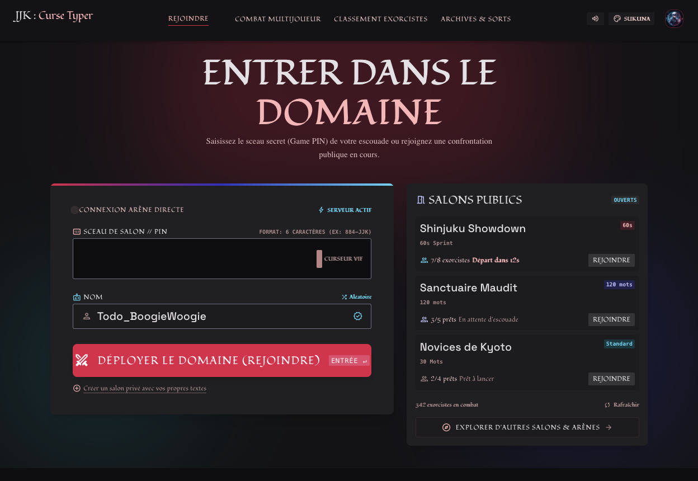 | 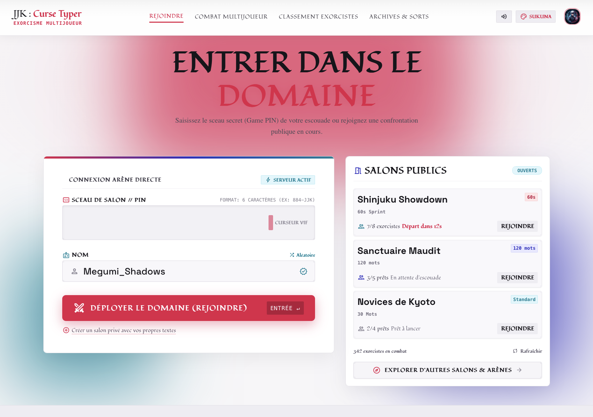 | 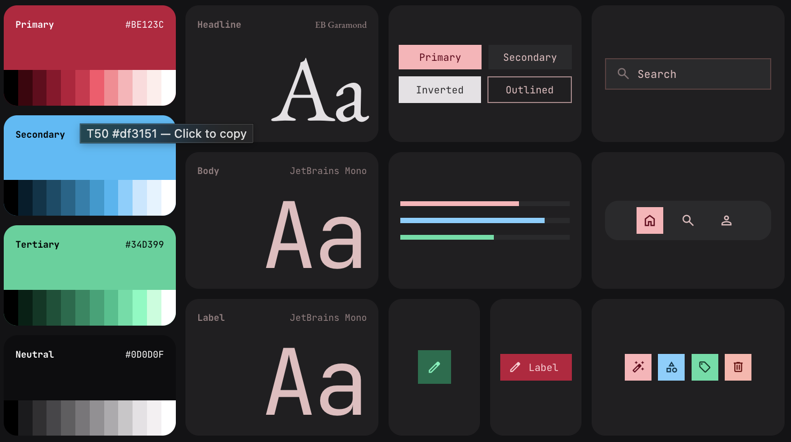 |

## Maquettes (Miro)

| Page | Maquette |
|---|---|
| Recherche de lobby | 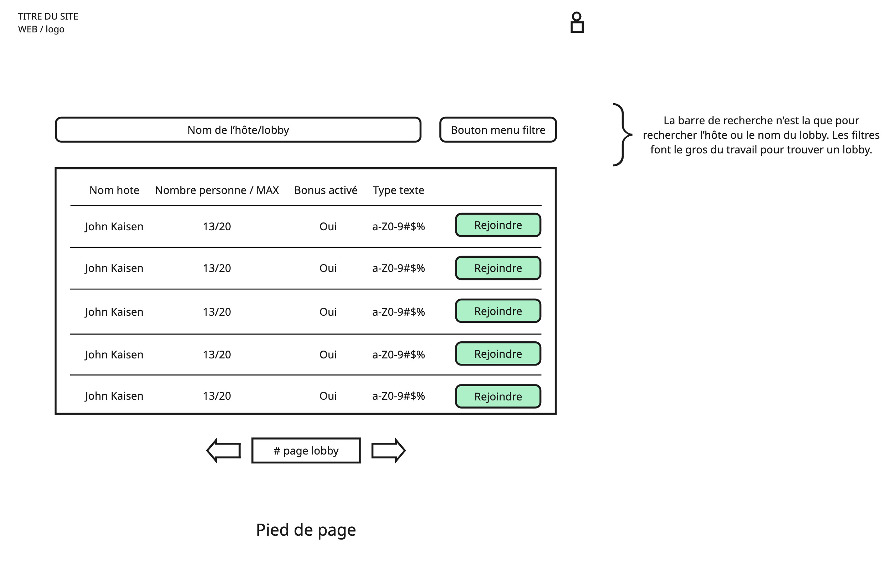 |
| Lobby, participant | 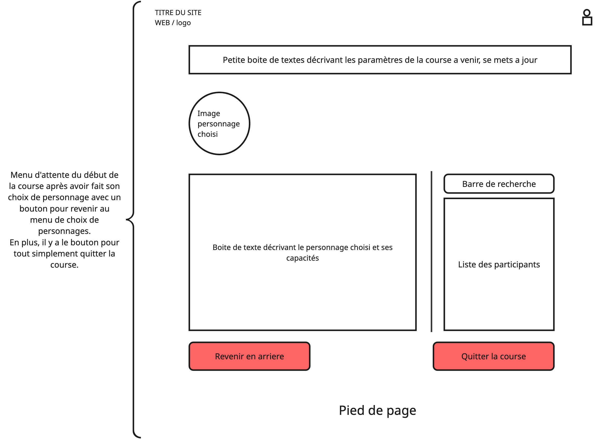 |
| Lobby, sélection du personnage | 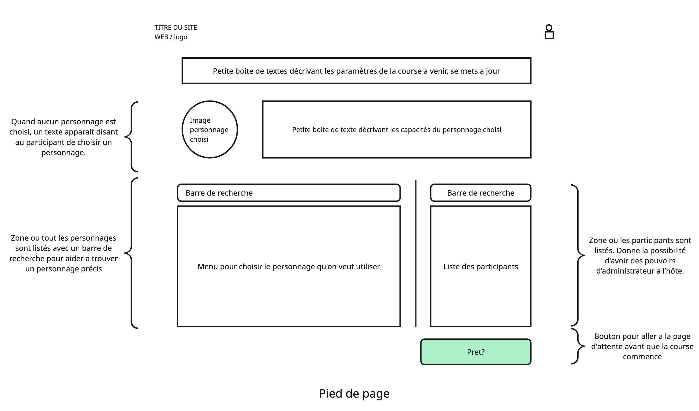 |
| Lobby, paramétrage (participant ou spectateur) | 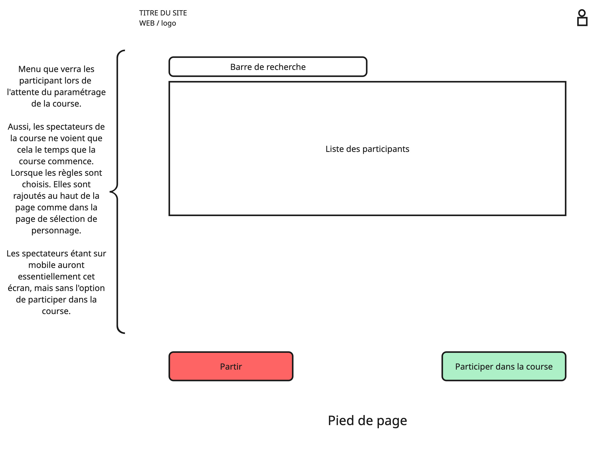 |
| Lobby, paramétrage de la course suivante (hôte) | 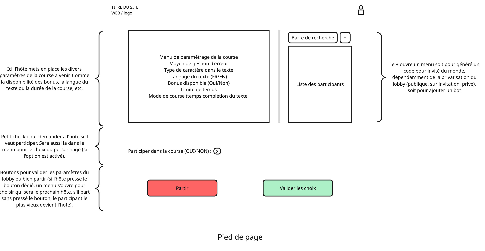 |
| Course | 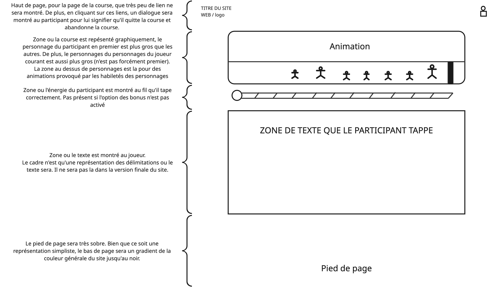 |
| Fin de course | 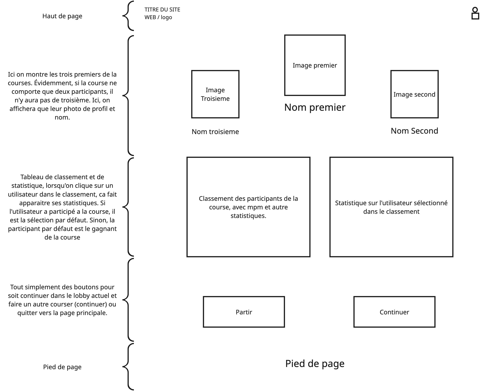 |
| Classement | 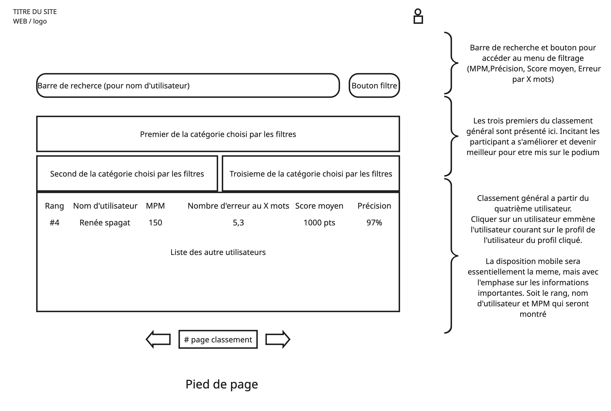 |
| Page de profil | 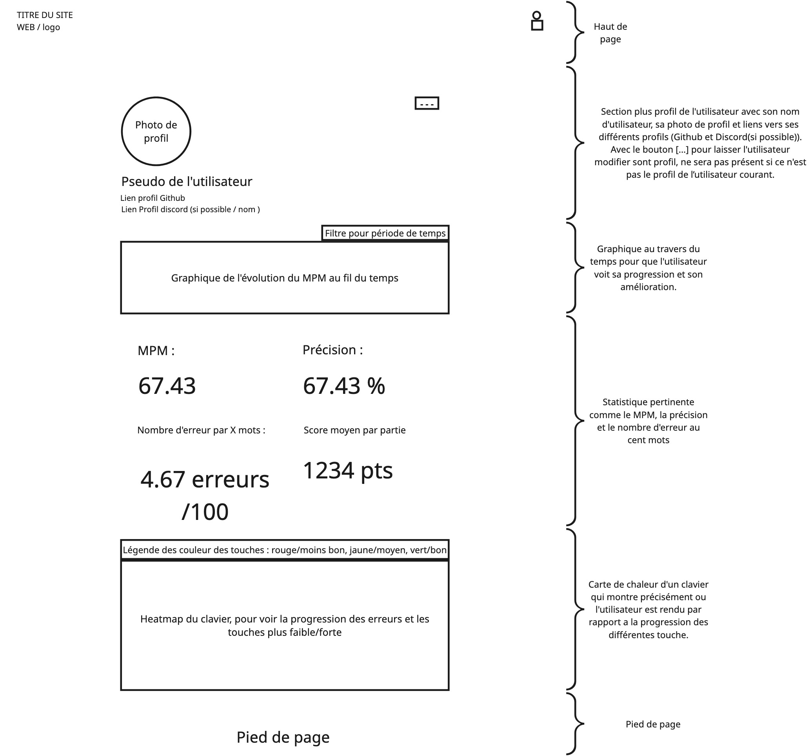 |
| Modification du profil | 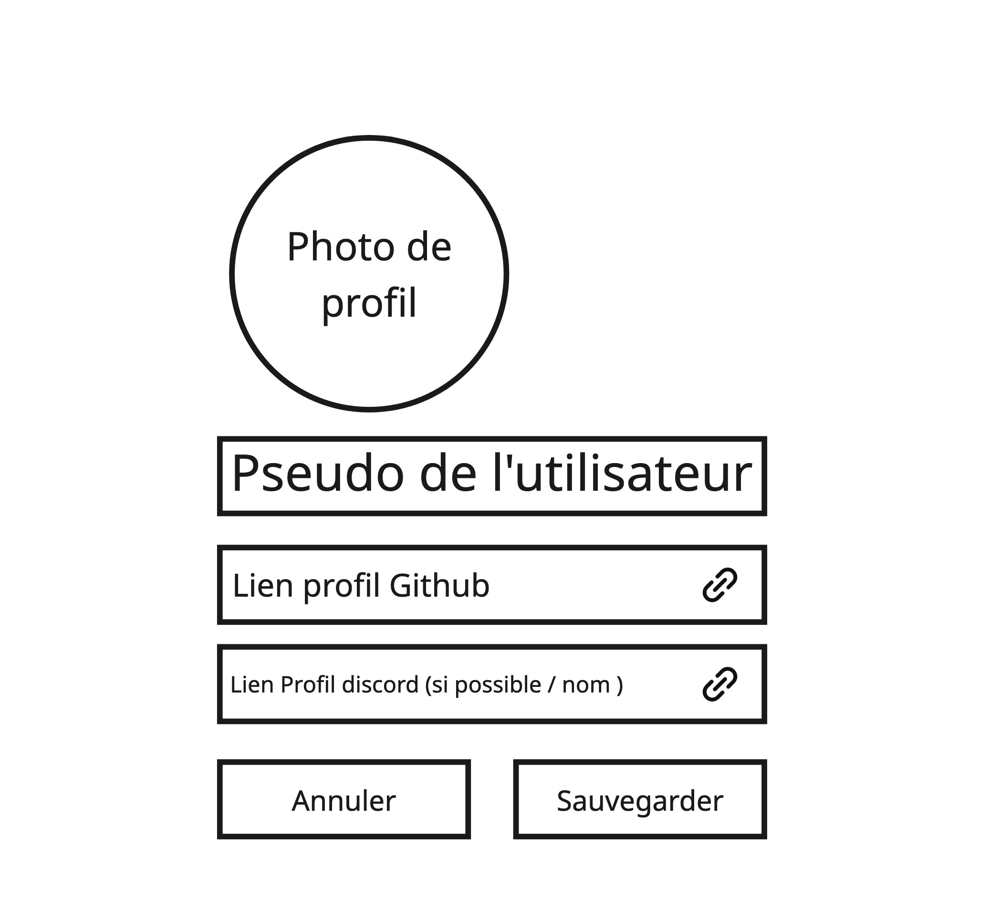 |
